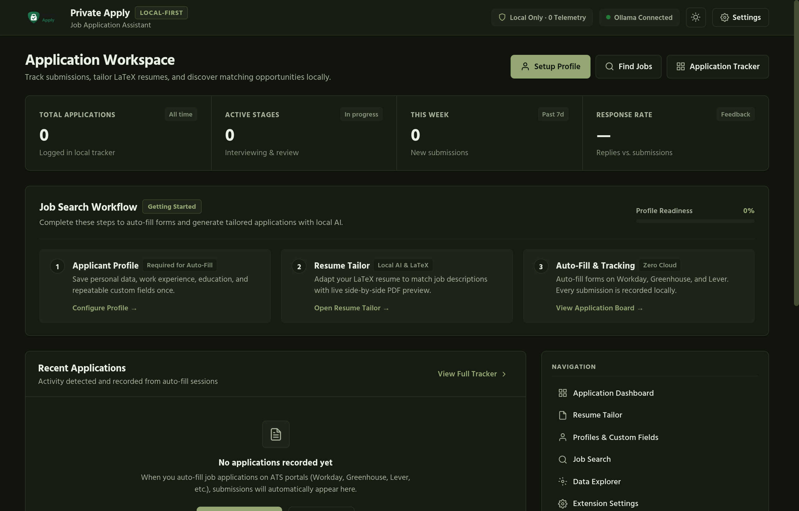
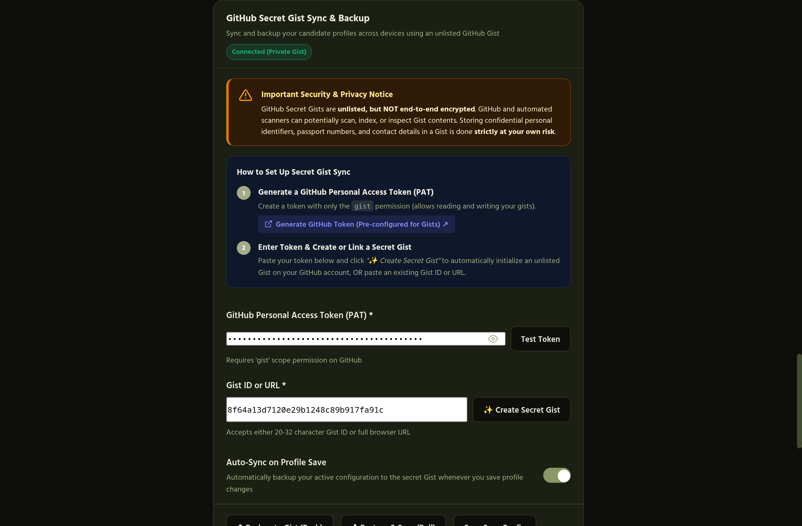
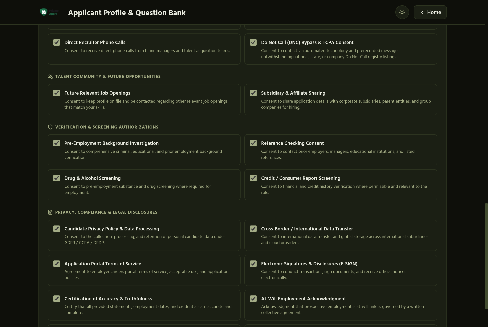
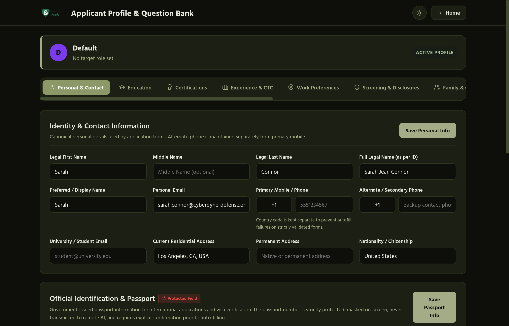
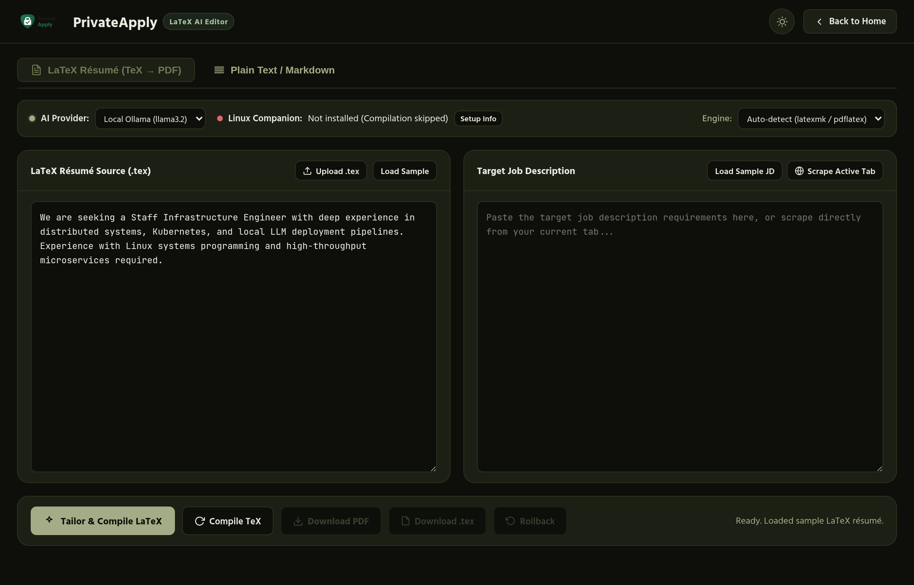
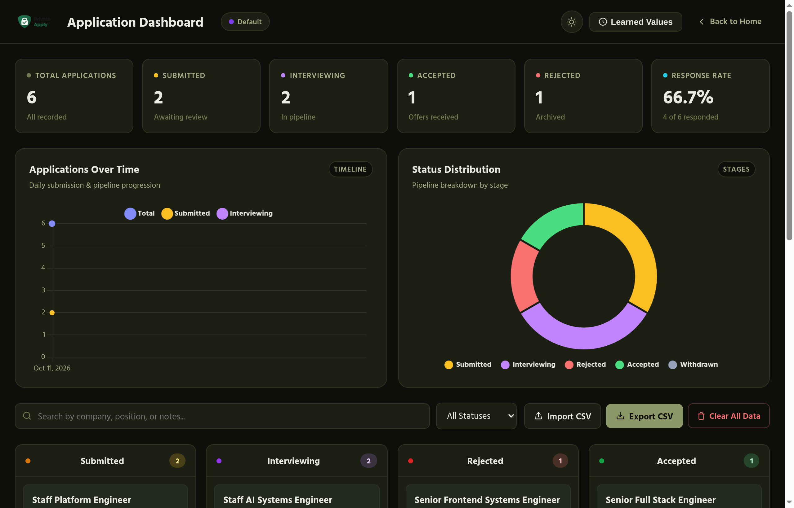
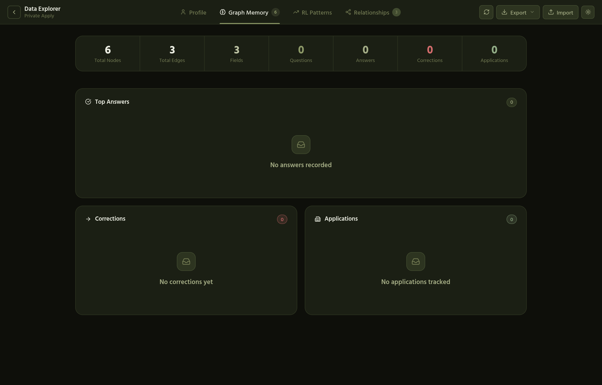
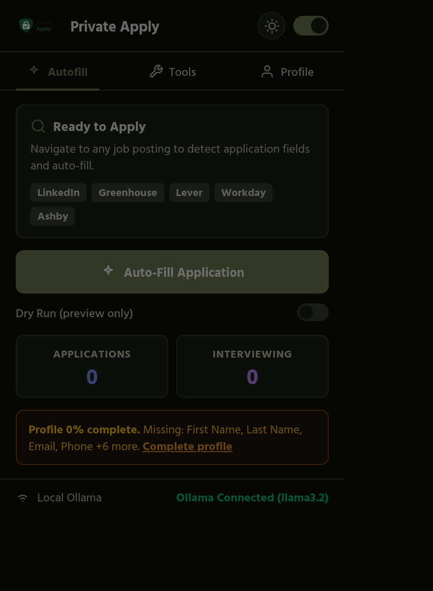
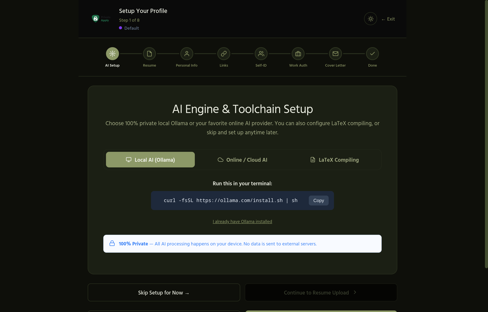
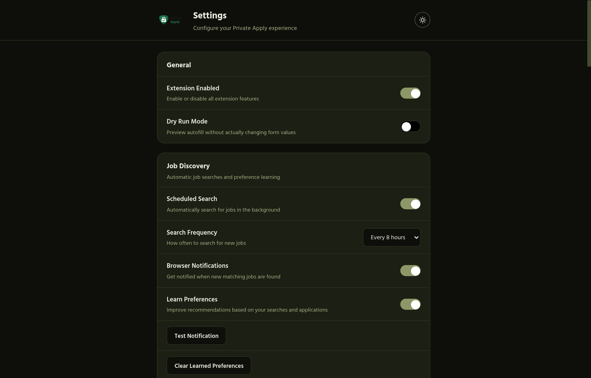

<div align="center">
  
  <h3>Privacy-first job application assistant for Chrome & Firefox</h3>
  <p>Auto-fill forms · AI LaTeX résumé tailor · Secret Gist sync · Local Ollama · Zero cloud · Zero tracking</p>

  <p>
    <a href="https://github.com/joelnishanth/private-apply/blob/main/LICENSE">
      
    </a>
    
    
    
    
    
    
  </p>

  <p>
    <a href="https://chromewebstore.google.com/detail/private-apply-job-applicat/bjllpojjllhfghiemokcoknfmhpmfbph"><strong>Get for Chrome</strong></a> ·
    <a href="https://addons.mozilla.org/en-US/firefox/addon/private-apply/"><strong>Get for Firefox</strong></a> ·
    <a href="https://joelnishanth.github.io/private-apply"><strong>Website</strong></a> ·
    <a href="#getting-started"><strong>Quick Start</strong></a> ·
    <a href="#featured-capabilities"><strong>New Features</strong></a> ·
    <a href="#acknowledgments--credits"><strong>Credits</strong></a> ·
    <a href="CONTRIBUTING.md"><strong>Contributing</strong></a> ·
    <a href="https://github.com/joelnishanth/private-apply/issues/new/choose"><strong>Report a Bug</strong></a>
  </p>

  <blockquote>
    <p><strong>Note:</strong> PrivateApply is a hard fork of <a href="https://github.com/offlyn-ai/offlyn-apply"><strong>offlyn-ai/offlyn-apply</strong></a>, originally created by <a href="https://github.com/joelnishanth"><strong>@joelnishanth</strong></a> (Joel Nishanth).</p>
  </blockquote>

  <br/>

  

</div>

---

## What It Does

**PrivateApply** automatically detects job application forms across 50+ ATS platforms (Workday, Greenhouse, Lever, Ashby, BambooHR, and bespoke portals), instantly autofilling complex fields from your structured local profile. It combines local AI intelligence with absolute privacy: all inference runs directly on your machine via [Ollama](https://ollama.com), requiring **zero external server communication** and uploading **zero personal telemetry**.

PrivateApply features a dedicated **AI LaTeX Résumé Tailor** that boundedly modifies your `.tex` source code to match job descriptions without breaking macros or styling, compiling PDFs locally via a native desktop companion. It also includes **GitHub Secret Gist Sync** for cross-device backup, a **Multi-Profile Candidate Hub**, **Comprehensive Legal & Contact Consents**, and a visual **Application Tracker Kanban Board**.

### Feature Matrix

| Feature | Description | Architecture / Privacy |
|---|---|---|
| **Smart Auto-Fill** | Detects ATS fields, nested dropdowns, radio matrices, and custom questions in seconds | 100% Client-side DOM matching & heuristic classification |
| **GitHub Secret Gist Sync** | Encrypted/unlisted cross-device profile backup with schema evolution tolerance | Direct GitHub API via user PAT token (zero intermediary servers) |
| **Comprehensive Consents** | Auto-fills WhatsApp updates, SMS/calls, DNC bypass, background checks & legal disclosures | Fully customizable in Profile Hub; granular opt-in/opt-out control |
| **AI LaTeX Résumé Tailor** | Tailors `.tex` resumes to job descriptions while preserving exact document formatting | AST-bounded diff engine; local TeX compilation via Native Messaging |
| **Linux TeX Companion** | Direct headless compilation to high-fidelity PDF via `pdflatex` or `latexmk` | Chrome/Firefox Native Messaging Host running in isolated sandbox |
| **Candidate Profile Hub** | 10+ categorized sections: Personal, Education, Experience, CTC, Legal, Social & Packs | Masked passport & national ID fields; protected against AI leakage |
| **Application Tracker** | Interactive Kanban dashboard with status pipelines, daily trends, and response metrics | Stored in `browser.storage.local`; CSV export & import support |
| **Data Graph & Memory** | Visual React Flow knowledge graph mapping field relationships and RL corrections | Learns from your manual edits to continuously improve autofill accuracy |
| **Dual-Browser Native** | Single source of truth producing native Chrome (MV3) and Firefox (MV2) packages | Unified esbuild compiler; zero duplicate authoring |

---

## Featured Capabilities

### 1. GitHub Secret Gist Sync & Backup

Sync your applicant profiles, custom questions, and configurations across multiple workstations seamlessly without relying on a centralized cloud backend.

<div align="center">
  
</div>

- **Zero Cloud Intermediaries:** PrivateApply communicates directly with GitHub's REST API using your Personal Access Token (`gist` scope). There is no PrivateApply server, database, or analytics proxy.
- **Prominent Security & Threat Model Notice:** The extension explicitly warns users that secret Gists are unlisted but not end-to-end encrypted on GitHub's servers. Highly sensitive fields (such as passport numbers) are shielded.
- **Interactive Setup Wizard:** Guided 2-step setup with direct links to pre-configured GitHub token generation and a 1-click **✨ Create Secret Gist** initialization button.
- **Schema Evolution & Resilience:** Built with robust forward and backward compatibility:
  - If new profile fields are added in newer extension versions, older Gist backups load seamlessly without crashing (new fields default cleanly to empty values).
  - If a schema structure is modified, PrivateApply highlights differences and prompts you to review changes rather than corrupting existing data types.
- **Auto-Sync & Manual Push/Pull:** Automatically syncs changes on profile save, or allows manual review with side-by-side modification alerts.

---

### 2. Comprehensive Applicant Consents & Authorizations

Modern job applications increasingly require numerous explicit checkboxes and legal disclosures. PrivateApply includes dedicated support for every standard and modern consent category:

<div align="center">
  
</div>

- **Communication Channels:**
  - **WhatsApp Message Consent:** Consent to receive application status updates, interview schedules, and recruiter messages via WhatsApp.
  - **Direct Recruiter Phone Calls & SMS:** Authorizations for recruiter voice calls and SMS text notifications.
  - **Do Not Call (DNC) Bypass & TCPA:** Explicit consent to automated notifications and calls notwithstanding national, state, or internal Do Not Call registries.
- **Talent Community & Future Opportunities:**
  - **Future Relevant Job Openings:** Retain candidate profile on file for future matching roles.
  - **Corporate Subsidiary & Affiliate Sharing:** Consent to share profile data across corporate parent entities and subsidiaries.
- **Screening & Verification Authorizations:**
  - **Pre-Employment Background Investigation:** Comprehensive criminal, educational, and prior employment checks.
  - **Drug & Alcohol Screening:** Substance testing acknowledgment where legally required.
  - **Reference Checking & Consumer Credit Reports:** Permissions to contact past managers and evaluate financial history.
- **Legal Disclosures & Compliance:**
  - **At-Will Employment Acknowledgment** & **Arbitration Agreements**.
  - **Automated AI Screening & Video Evaluation Consent:** Required disclosures for AI-driven hiring algorithms.
  - **Candidate Privacy (GDPR, CCPA, DPOP)** & **E-Sign Electronic Disclosure Agreements**.

---

### 3. Candidate Profile Hub & Multi-Profile Manager

Manage distinct profiles for different career tracks (e.g., *Staff Infrastructure Engineer* vs. *AI Research Scientist*) with granular control over each field:

<div align="center">
  
</div>

- **10+ Dedicated Hub Sections:** Identity & Contact, Education, Certifications & Social Links, Experience & CTC, Work Preferences, Screening & Disclosures, Family & Emergency, Country-Packs, Employment-Packs, and Custom Fields.
- **Masked Sensitive Storage:** Sensitive government identifiers (Passport Number, National ID) are visually masked on-screen, stored locally, and strictly barred from external AI prompts.
- **International Country-Packs:** Region-specific fields and demographic taxonomies for the US (EEO, Veteran, Disability), UK, Germany, and India.
- **Specialized Employment-Packs:** Custom question patterns tailored for Computer Science, Data Science, and Design roles.

---

### 4. AI LaTeX Résumé Editor & Linux TeX Companion

Tailor your existing LaTeX résumé source directly against job descriptions without mangling custom macros, geometry, or typographic styling.

<div align="center">
  
</div>

- **AST-Bounded Patching:** Rather than regenerating your entire document, PrivateApply computes granular, bounded replacements targeting bullet points and summaries, preserving macros (`\newcommand`), packages, and layout constraints.
- **Native TeX Companion:** Pairs with a local Native Messaging desktop companion (`private_apply_companion`) to invoke your installed `latexmk` or `pdflatex` distribution directly on Linux/macOS.
- **Compile-and-Repair Loop:** Automatically captures TeX compiler diagnostics, identifies syntax warnings or missing braces, and requests targeted auto-repairs from the local LLM.

---

### 5. Application Analytics & Kanban Dashboard

Track every submitted job application on a private, local Kanban board with submission trends and stage conversion analytics.

<div align="center">
  
</div>

- **Interactive Kanban Pipeline:** Drag and drop applications across **Submitted**, **Interviewing**, **Accepted**, and **Rejected** stages.
- **Submission Timeline:** Visual daily submission trend graph tracking weekly application velocity.
- **Status Breakdown Chart:** Live donut chart illustrating active pipeline health and response rates.
- **Complete Data Ownership:** 100% stored in local browser storage with one-click CSV export and import.

---

### 6. Data Graph & RL Memory Explorer

Inspect how PrivateApply's machine learning engine maps complex form fields to your personal profile.

<div align="center">
  
</div>

- **Visual Knowledge Graph:** Node-and-edge visualization powered by `@xyflow/react` showing semantic connections between ATS field labels, candidate attributes, and confidence weights.
- **Reinforcement Learning from Human Feedback (RLHF):** Whenever you manually correct an autofilled field, PrivateApply saves a reinforcement learning event that updates edge weights for future encounters.

---

## Interface Tour

<div align="center">
  <table>
    <tr>
      <td align="center" width="33%">
        <br/>
        <sub><b>Popup Command Center</b><br/>One-click auto-fill, dry run toggle & model status</sub>
      </td>
      <td align="center" width="33%">
        <br/>
        <sub><b>Setup Wizard</b><br/>Guided 8-step onboarding and Ollama toolchain setup</sub>
      </td>
      <td align="center" width="33%">
        <br/>
        <sub><b>Settings & Model Controls</b><br/>Local Ollama endpoints, temperature & context tuning</sub>
      </td>
    </tr>
  </table>
</div>

---

## Privacy Architecture

PrivateApply is engineered from first principles around a **local-first, zero-telemetry** guarantee:

```
[ Your Browser (Storage & DOM) ]
  ├── Candidate Profile Data (Encrypted & Masked locally)
  ├── Consents & Legal Authorizations
  ├── Application History & Kanban Data
  └── Learned Field Mappings (RL Graph)
         │
         ├── [ Local Machine: localhost:11434 (Ollama) ]
         │      ├── Model: llama3.2 / mistral / deepseek-r1
         │      └── AI Cover Letters & Résumé Tailoring (100% on hardware)
         │
         ├── [ Optional: Secret GitHub Gist Sync (Direct REST API) ]
         │      └── Unlisted Gist Backup using your personal PAT token
         │
         └── [ Local Native Messaging: TeX Companion ]
                └── Compiles LaTeX to PDF via local pdflatex / latexmk

  [ OUTSIDE WORLD: ZERO TRACKING · ZERO BACKEND · ZERO ANALYTICS ]
```

---

## Project Structure

The codebase uses a **unified single-source-of-truth architecture** that eliminates duplication between Chrome and Firefox while outputting clean, independent packages:

```
private-apply/
├── src/                          # Authoritative TypeScript & React source code (Single Source of Truth)
│   ├── background.ts             # Background service worker & execution scripts
│   ├── content.ts                # Primary DOM autofill engine & ATS observer
│   ├── content-whatsapp.ts       # WhatsApp Web synchronization script
│   ├── popup/                    # Extension popup controller
│   ├── onboarding/               # First-run resume parser & guided setup
│   ├── dashboard/                # Application analytics & Kanban dashboard
│   ├── profiles/                 # Candidate Profile Hub & multi-profile manager
│   ├── settings/                 # AI provider config, Gist sync, country packs
│   ├── jobs/                     # Job tracker & opportunity search
│   ├── resume-tailor/            # LaTeX tailoring engine & AST patcher
│   ├── data/                     # React Flow Data Graph & RL Memory Explorer
│   └── shared/                   # Gist sync, profile schemas, browser compat, ATS classifiers
├── public/                       # Authoritative HTML entrypoints, CSS stylesheets, icons & workers
├── browser/                      # Browser-specific configurations
│   ├── chrome/                   # Chrome Manifest V3 configuration
│   └── firefox/                  # Firefox Manifest V2 configuration & native host scripts
├── scripts/
│   ├── build.mjs                 # Unified esbuild multi-browser compiler
│   ├── package.mjs               # Release zip packaging script (.output/*.zip)
│   └── capture-screenshots.mjs   # Headless Chrome CDP screenshot capture script
├── assets/                       # Brand assets, logos, and updated UI screenshots
├── companion/                    # Python/Node native messaging TeX compilation host
├── .output/                      # Build destination (Chrome & Firefox unpacked extensions)
├── package.json
├── tsconfig.json
└── vitest.config.mts
```

---

## Getting Started

### 1. Requirements

- **Chrome** / Chromium / Brave / Edge (Manifest V3) or **Firefox 109+** (Manifest V2)
- **Node.js** 18+ (tested up to Node 24)
- **[Ollama](https://ollama.com)** installed and running locally with your chosen model:
  ```bash
  ollama serve
  ollama pull llama3.2
  ```

### 2. Clone and Install

```bash
git clone https://github.com/joelnishanth/private-apply.git
cd private-apply
npm install
```

### 3. Build the Extensions

```bash
# Build both Chrome and Firefox extensions simultaneously
npm run build

# Or build individual targets:
npm run build:chrome     # Compiles Chrome MV3 -> .output/chrome
npm run build:firefox    # Compiles Firefox MV2 -> .output/firefox

# Watch mode for rapid development:
npm run dev
```

### 4. Load in Your Browser

- **Google Chrome / Brave / Edge**:
  1. Open `chrome://extensions/`
  2. Toggle **Developer mode** in the top-right corner.
  3. Click **Load unpacked** and select the `.output/chrome` directory.

- **Mozilla Firefox**:
  1. Open `about:debugging#/runtime/this-firefox`
  2. Click **Load Temporary Add-on...**
  3. Select `.output/firefox/manifest.json`.

---

## Available Commands

| Command | Action | Output Destination |
|---|---|---|
| `npm run build` | Compiles both Chrome and Firefox extensions | `.output/chrome/`, `.output/firefox/` |
| `npm run build:chrome` | Compiles Chrome MV3 extension | `.output/chrome/` |
| `npm run build:firefox` | Compiles Firefox MV2 extension | `.output/firefox/` |
| `npm run dev` | Rebuilds automatically on source file changes | `.output/` |
| `npm run package` | Produces production-ready `.zip` archives for store release | `.output/private-apply-{chrome,firefox}.zip` |
| `npm test` | Runs the full Vitest suite (461 tests) | Terminal report |
| `npm run screenshots` | Captures updated screenshots via headless Chrome CDP | `assets/` |

---

## Testing & Quality Assurance

PrivateApply maintains comprehensive test coverage across parser validation, profile serialization, schema migrations, ATS classifiers, semantic matching, and cross-browser compilation:

```bash
npm test
```

```
Test Files  23 passed (23)
Tests       461 passed (461)
Duration    1.36s
```

---

## Contributing

Contributions are welcome! Please consult [CONTRIBUTING.md](CONTRIBUTING.md) for architectural guidelines, coding standards, and PR workflows.

- **Good first issues:** Look for the [`good first issue`](https://github.com/joelnishanth/private-apply/labels/good%20first%20issue) label on GitHub.
- **Reporting issues:** Please submit detailed reproduction steps via [GitHub Issues](https://github.com/joelnishanth/private-apply/issues/new/choose).

---

## Security & Responsible Disclosure

If you discover a security vulnerability, please follow the disclosure instructions in [SECURITY.md](SECURITY.md) instead of opening a public ticket.

---

## Acknowledgments & Credits

PrivateApply is a hard fork of **[Offlyn Apply](https://github.com/offlyn-ai/offlyn-apply)** created by **[@joelnishanth](https://github.com/joelnishanth)** (Joel Nishanth).

Heartfelt gratitude and full credit go to **Joel Nishanth** and the Offlyn AI community for pioneering the local-first, zero-tracking philosophy for job application assistance. This project builds upon Joel's original vision and core concepts, expanding it with:
- A unified single-source-of-truth codebase supporting both Chrome (Manifest V3) and Firefox (Manifest V2).
- An AST-bounded AI LaTeX Résumé Tailor paired with a local Native Messaging TeX Companion.
- Cross-workstation GitHub Secret Gist configuration sync with forward/backward schema resilience.
- Expanded legal, communication, and background check applicant consents (WhatsApp, TCPA/DNC bypass, drug screenings, arbitration, AI screening).
- A modular Candidate Profile Hub, international country packs, and React Flow Data Graph Memory Explorer.

---

## License

[MIT](LICENSE) — © 2026 [Private Apply](https://github.com/joelnishanth/private-apply)
